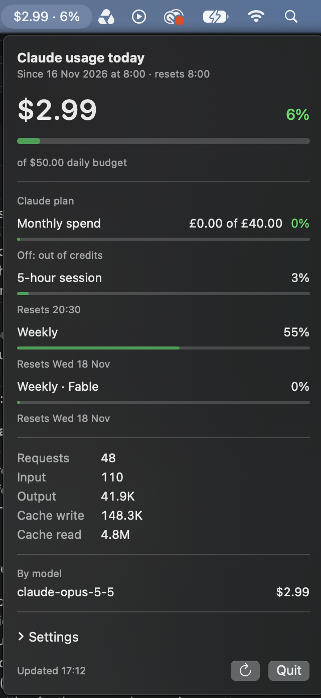
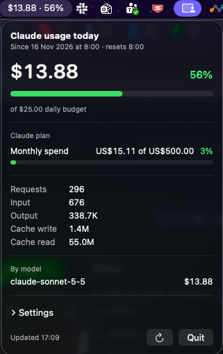
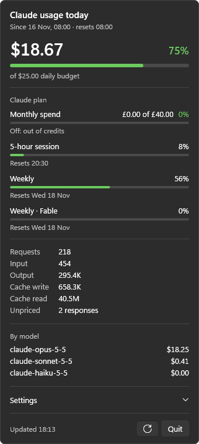

# Claude Usage

**See what your Claude Code usage is worth today, at a glance, in the macOS menu bar or on the Windows desktop.**

```
$12.34 · 25%
```

Today's cost at Anthropic API list prices, and how much of your daily budget that is, always in view. Click it for the full picture: your Claude plan's limits, token counts and the cost per model.

<table align="center">
  <tr>
    <td valign="top" align="center">
      <br>
      <sub><b>macOS</b> · Max plan</sub>
    </td>
    <td valign="top" align="center">
      <br>
      <sub><b>macOS</b> · Enterprise plan</sub>
    </td>
    <td valign="top" align="center">
      <br>
      <sub><b>Windows</b> · dark mode</sub>
    </td>
  </tr>
</table>

## Get it

| | Lives in | Needs | Setup |
|---|---|---|---|
| **macOS** | The menu bar | macOS 13+ and the Swift tools | [mac/README.md](mac/README.md) |
| **Windows** | The tray, plus a small floating widget | Windows 10/11 and .NET 10 | [windows/README.md](windows/README.md) |

## What it shows

- **Today's cost and budget %**: `$12.34 · 25%` in the menu bar (macOS) or a floating widget and tray badge (Windows). It turns orange at 75% of your budget and red at 100%.
- **A working day, not a calendar day**: the total resets at 8 AM (or the hour you choose), so a late night counts towards the day it started.
- **Your Claude plan**: monthly spend against your cap (Enterprise spend limit, or usage credits on Pro and Max), and the 5-hour session and weekly limits with their reset times. These are the same figures as Claude Code's `/usage` screen.
- **Where it went**: requests, input and output tokens, cache writes and reads, and the cost per model.
- **Light and dark**: follows your system theme.

## How it works

Claude Code keeps a transcript of every session on your machine. The app reads those logs, drops the duplicate entries Claude Code writes while a response streams, and prices each response from Anthropic's published list prices. The daily total never leaves your computer.

The plan section uses the login Claude Code has already saved to ask Claude for your account's usage. That one request goes only to `api.anthropic.com`; the token is never stored, logged or refreshed. Turn the section off and the app makes no network requests at all.

> The dollar figure is what your usage *would* cost at API list prices. On a Pro or Max subscription you aren't billed per token, so read it as the value you're getting.

## Repository layout

```
mac/        The macOS menu bar app (Swift, SwiftUI). Setup: mac/README.md
windows/    The Windows tray app (C#, .NET 10, WPF). Setup: windows/README.md
docs/       Screenshots.
```

Each app has its own copy of the core logic (log scanning, pricing, the day window and the plan-usage parser) with the same tests. When prices change, update both `Pricing` files.
