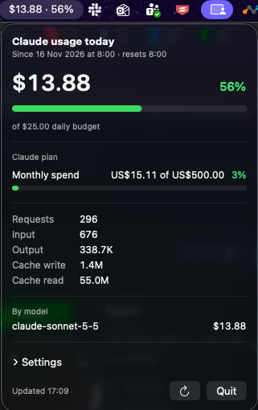
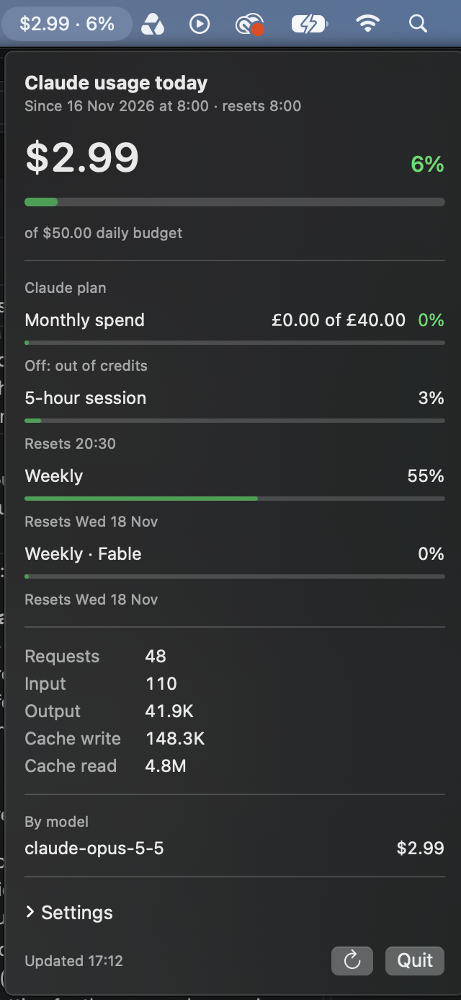

# Claude Usage – macOS menu bar widget

A small menu bar app that shows how much you've spent on Claude today, for example:

```
$12.34 · 25%
```

- **Cost** is the dollar cost of today's Claude Code usage at Anthropic API list prices.
- **%** is that cost as a share of a daily budget you set (default $25).
- **Today** runs from **8:00 AM to 8:00 AM** local time, so the counter goes back to $0.00 at 8 AM each morning. You can change the hour.

Click the item to open a panel. It shows the cost, a progress bar against the budget, your Claude plan's monthly spend and limits, token counts (input, output, cache write and cache read), a cost breakdown per model, and the settings.

<table align="center">
  <tr>
    <td valign="top" align="center">
      <br>
      <sub>Enterprise: monthly spend limit</sub>
    </td>
    <td valign="top" align="center">
      <br>
      <sub>Max: usage credits and plan limits</sub>
    </td>
  </tr>
</table>

## Requirements

- macOS 13 Ventura or later
- Xcode 15+ or the Swift 5.9+ command line tools (`xcode-select --install`)

## Build and run

Run these from this `mac/` folder:

```bash
cd mac

# Quick run from the terminal (no .app bundle; "Launch at login" won't work this way)
swift run ClaudeUsageBar

# Build a proper menu-bar-only app at build/Claude Usage.app
scripts/build-app.sh

# ...or build it, copy it to /Applications, and launch it
scripts/build-app.sh --install
```

You can also open `Package.swift` in Xcode and run the `ClaudeUsageBar` scheme.

The app icon is drawn by `scripts/make-icon.swift`. After changing the design, run `scripts/make-icon.sh` to regenerate `Resources/AppIcon.icns`.

Run the tests (they cover pricing, the 8 AM day window and log parsing):

```bash
swift test
```

## Settings (in the panel)

| Setting | Default | Notes |
|---|---|---|
| Daily budget ($) | 25 | The amount that counts as 100%. The bar turns orange at 75% and red at 100%. |
| Day starts at | 8:00 AM | The hour the daily total resets to zero. |
| Menu bar shows | Cost and % | Or cost only, or % only. |
| Data folder | `~/.claude` and `~/.config/claude` | Comma-separated list of Claude config folders, if you use `CLAUDE_CONFIG_DIR`. |
| Show Claude plan usage | on | Fetches monthly spend and plan limits from Claude using Claude Code's login. Turn off for no network access. |
| Launch at login | off | Needs the `.app` bundle from `scripts/build-app.sh`. |

## Where the numbers come from

Claude Code writes a transcript of every session to `~/.claude/projects/**/*.jsonl`. Each assistant message in those files records its token usage: input, output, 5-minute and 1-hour cache writes, cache reads, model, and fast mode. The app:

1. reads the transcripts changed since the current period began (subagent logs included),
2. drops duplicate copies of a response (Claude Code logs a response more than once while it streams),
3. prices each response from the table in `Sources/UsageCore/Pricing.swift`, and adds them up.

The daily total is worked out entirely on your Mac. It refreshes every 60 seconds and whenever you open the panel.

> **Note:** The figure is what this usage *would* cost at API list prices. On a Pro or Max subscription you aren't billed per token, so treat it as the value of your usage. Prices were last checked in November 2026. When they change, update `Pricing.swift` and its Windows twin, `windows/src/UsageCore/Pricing.cs`. Responses from models missing from the table appear as "Unpriced" and add $0.

## Claude plan usage (monthly spend and limits)

The **Claude plan** section shows usage as Claude itself reports it for the account you're signed in to in Claude Code:

- **Monthly spend**: what you've spent this period against your monthly cap, in your billing currency. On an Enterprise plan this is your spend limit; on Pro or Max it is the usage-credits cap. The reset date appears when Claude reports one.
- **Plan limits**: the 5-hour session and weekly limits (and any per-model ones), each with its reset time.

These figures cover all your Claude usage on every device, unlike the daily total, which only counts Claude Code on this Mac.

How it works: the app reads Claude Code's saved login from the macOS Keychain (via `/usr/bin/security`, the same way Claude Code reads it). It then calls `https://api.anthropic.com/api/oauth/usage` about every 5 minutes; that endpoint is the one behind Claude Code's `/usage` screen. The token is sent only to api.anthropic.com and is never stored or logged. The app never refreshes the token. If the login has expired, the panel asks you to use Claude Code, which renews it.

> **Note:** That endpoint is undocumented and may change without notice. If it does, the section shows an error and the rest of the app keeps working. You can turn the section off in Settings ("Show Claude plan usage"); with it off, the app makes no network requests.

## Project layout

```
Sources/UsageCore/        Foundation-only logic (pricing, day window, log scanning). Unit tested.
Sources/ClaudeUsageBar/   SwiftUI MenuBarExtra app.
Tests/UsageCoreTests/     XCTest suite for UsageCore.
Resources/Info.plist      Bundle metadata (LSUIElement = menu bar only, no Dock icon).
scripts/build-app.sh      Builds a release binary and wraps it in an ad-hoc signed .app.
```
