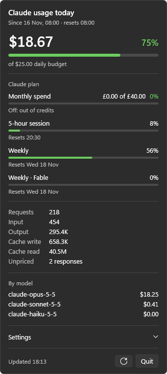

# Claude Usage – Windows tray widget

The Windows version of the [macOS menu bar app](../mac/README.md). It shows how much you've spent on Claude today:

- a **floating widget** showing `$12.34 · 25%`, like the macOS menu bar text, which you can drag anywhere;
- a **tray icon** showing today's % in green, orange or red, with the details in its tooltip.

- **Cost** is the dollar cost of today's Claude Code usage at Anthropic API list prices.
- **%** is that cost as a share of a daily budget you set (default $25).
- **Today** runs from **8:00 AM to 8:00 AM** local time, so the counter goes back to $0.00 at 8 AM each morning. You can change the hour.

Click the widget or the tray icon to open a panel. It shows the cost, a bar against the budget, your Claude plan's monthly spend and limits, token counts (input, output, cache write and cache read), a cost breakdown per model, and the settings. Click anywhere else or press Esc to close it. Right-click either one for Open, Refresh now, Show floating widget and Quit.

<p align="center">
  
</p>

Windows 11's taskbar can't show text the way the macOS menu bar does. That's why the tray icon shows a number and the floating widget carries the full text.

## Requirements

- Windows 10 (version 2004 or later) or Windows 11
- To build: the [.NET 10 SDK](https://dotnet.microsoft.com/download) (`winget install Microsoft.DotNet.SDK.10`)
- To run the default build: the .NET 10 Desktop Runtime, which comes with the SDK. Use `-SelfContained` (below) to build an exe that doesn't need it.

## Build and run

Run these in PowerShell from this `windows/` folder:

```powershell
cd windows

# Build it, install it to %LOCALAPPDATA%\Programs\Claude Usage, add a Start menu shortcut, and launch it
scripts/build.ps1 -Install

# ...or just build a single exe at build/ClaudeUsage.exe
scripts/build.ps1

# Bundle the .NET runtime too (about 70 MB), for PCs without .NET 10
scripts/build.ps1 -SelfContained

# Quick run from source while developing ("Launch at login" would point at the bin folder)
dotnet run --project src/ClaudeUsageTray
```

> **Tip:** Windows 11 puts new tray icons in the hidden `^` overflow. To keep the icon on the taskbar, drag it out of the overflow, or turn it on in **Settings → Personalization → Taskbar → Other system tray icons**. The floating widget is on by default so you can see the figures straight away. You can turn it off once the tray icon is pinned.

Only one copy runs at a time. Launching it again (for example from the Start menu) opens the panel of the copy that's already running.

Run the tests (they cover pricing, the 8 AM day window including DST changes, log parsing and the plan-usage response):

```powershell
dotnet test
```

The app icon is drawn by `scripts/make-icon.ps1`, using the same gauge design as the macOS icon. After changing the design, run it again to regenerate `src/ClaudeUsageTray/AppIcon.ico`.

To render the panel, widget and tray badges in light and dark mode to PNG files without showing anything on screen, run `ClaudeUsage.exe --snapshot <folder>`. This is handy for checking layout changes.

## Settings (in the panel)

Settings are saved to `%APPDATA%\ClaudeUsage\settings.json`.

| Setting | Default | Notes |
|---|---|---|
| Daily budget ($) | 25 | The amount that counts as 100%. Colours turn orange at 75% and red at 100%. |
| Day starts at | 8:00 AM | The hour the daily total resets to zero. |
| Tray icon shows | Percent used | Or whole dollars spent. |
| Widget shows | Cost and % | Or cost only, or % only. |
| Data folder | `%USERPROFILE%\.claude` and `%USERPROFILE%\.config\claude` | Comma-separated list of Claude config folders, if you use `CLAUDE_CONFIG_DIR`. |
| Show floating widget | on | Hidden automatically while a full-screen app (game, video, presentation) is in front. |
| Show Claude plan usage | on | Fetches monthly spend and plan limits from Claude using Claude Code's login. Turn off for no network access. |
| Launch at login | off | Adds the app to `HKCU\Software\Microsoft\Windows\CurrentVersion\Run`. Turn it on from the installed copy (`scripts/build.ps1 -Install`). |

## Where the numbers come from

This works the same way as the macOS app, and uses the same pricing table and rules. Claude Code writes a transcript of every session to `%USERPROFILE%\.claude\projects\**\*.jsonl`. Each assistant message in those files records its token usage. The app:

1. reads the transcripts changed since the current period began (subagent logs included). It reads them in shared mode, so it never gets in the way of Claude Code writing them;
2. drops duplicate copies of a response (Claude Code logs a response more than once while it streams);
3. prices each response from the table in `src/UsageCore/Pricing.cs`, and adds them up.

The daily total is worked out entirely on your PC. It refreshes every 60 seconds, whenever you open the panel, and when the PC wakes from sleep.

> **Note:** The figure is what this usage *would* cost at API list prices. On a Pro or Max subscription you aren't billed per token, so treat it as the value of your usage. `Pricing.cs` mirrors the macOS app's `mac/Sources/UsageCore/Pricing.swift`; update both when prices change. Responses from models missing from the table appear as "Unpriced" and add $0.

## Claude plan usage (monthly spend and limits)

The **Claude plan** section shows usage as Claude itself reports it for the account you're signed in to in Claude Code:

- **Monthly spend**: what you've spent this period against your monthly cap, in your billing currency. On an Enterprise plan this is your spend limit; on Pro or Max it is the usage-credits cap.
- **Plan limits**: the 5-hour session and weekly limits (and any per-model ones), each with its reset time.

These figures cover all your Claude usage on every device, not just Claude Code on this PC.

How it works: on Windows, Claude Code saves its login in `%USERPROFILE%\.claude\.credentials.json` (or in `CLAUDE_CONFIG_DIR`). The app reads the access token from there and calls `https://api.anthropic.com/api/oauth/usage` about every 5 minutes. That endpoint is the one behind Claude Code's `/usage` screen. The token is sent only to api.anthropic.com and is never stored or logged. The app never refreshes the token. If the login has expired, the panel asks you to use Claude Code, which renews it.

> **Note:** That endpoint is undocumented and may change without notice. If it does, the section shows an error and the rest of the app keeps working. You can turn the section off in Settings ("Show Claude plan usage"); with it off, the app makes no network requests.

## Project layout

```
src/UsageCore/          Platform-neutral logic (pricing, day window, log scanning, plan usage). Unit tested.
src/ClaudeUsageTray/    The WPF tray app: tray icon, floating widget, panel, settings.
tests/UsageCore.Tests/  xUnit tests, ported from the macOS app's XCTest suite.
scripts/build.ps1       Publishes a single-file exe to build/ (and optionally installs it).
scripts/make-icon.ps1   Draws AppIcon.ico.
```
